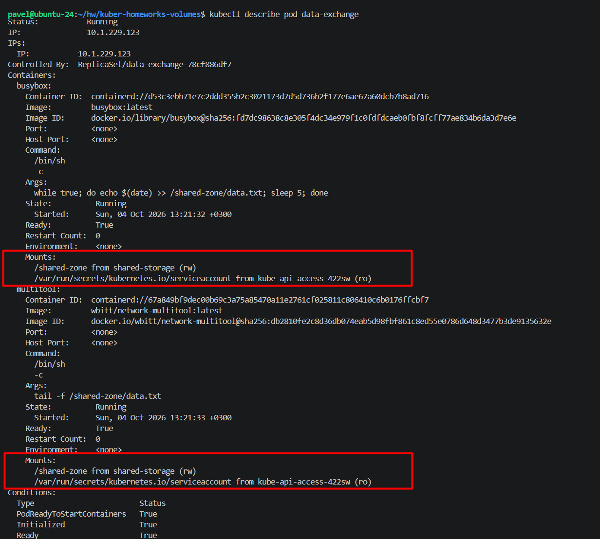
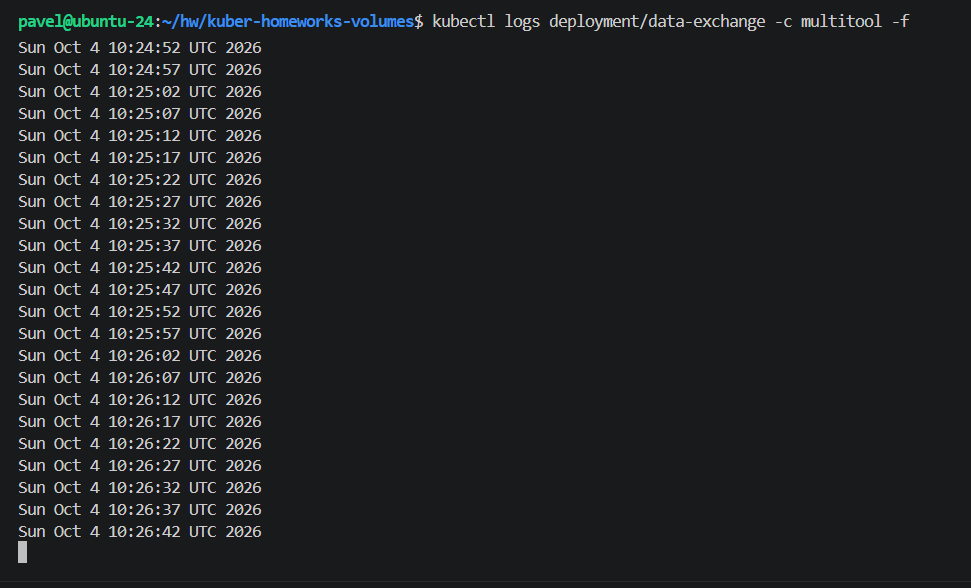
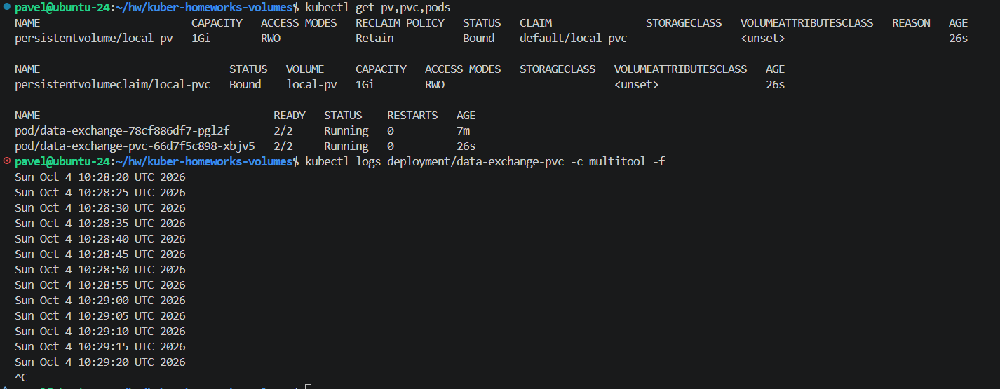
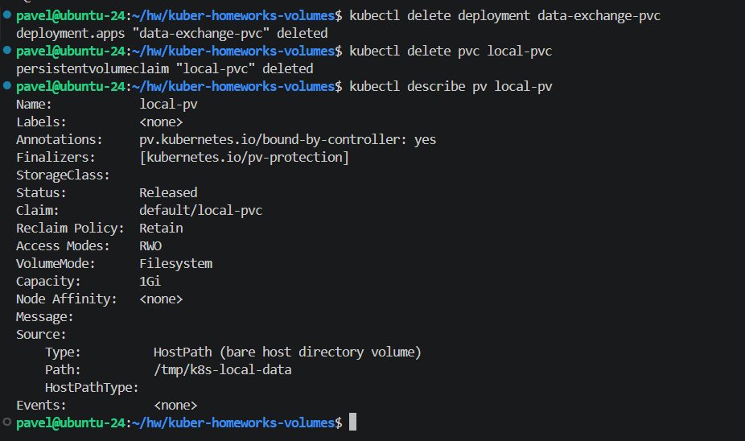
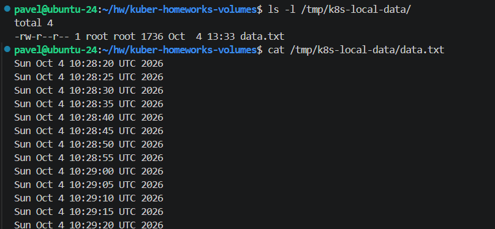
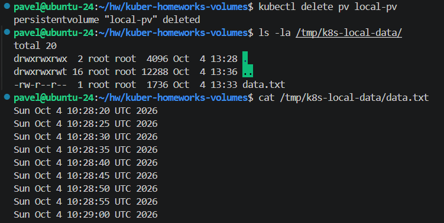
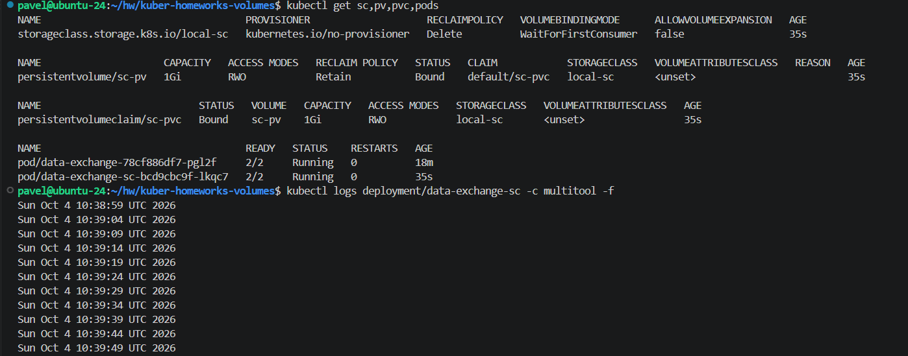

# Домашнее задание к занятию «`Хранение в K8s`» - `Рыбянцев Павел`

------

Репозиторий содержит манифесты и отчёт о выполнении домашнего задания. Локальный кластер развернут с помощью MicroK8s.

---

## Задание 1. Volume: обмен данными между контейнерами в поде

### Исходные файлы:
* Манифест деплоймента: [task1/containers-data-exchange.yaml](task1/containers-data-exchange.yaml)

### Описание решения:
1. Создан Deployment `data-exchange` с одной репликой, содержащий два контейнера: `busybox` и `multitool`.
2. Контейнеры обмениваются данными через эфемерное хранилище типа `emptyDir`, смонтированное на уровне пода. Папка общего доступа внутри обоих контейнеров — `/shared-zone`.
3. Контейнер `busybox` настроен на запись текущей даты каждые 5 секунд, а `multitool` считывает её в реальном времени с помощью команды `tail -f`.

### Проверка работоспособности:
* Описание пода с контейнерами:
  ```bash
  kubectl describe pods data-exchange
  ```


* Вывод команды чтения файла из контейнера `multitool`:
  ```bash
  kubectl logs deployment/data-exchange -c multitool -f
  ```


---

## Задание 2. PV, PVC

### Исходные файлы:
* Манифест PV, PVC и Deployment: [task2/pv-pvc.yaml](task2/pv-pvc.yaml)

### Описание решения:
1. Создан локальный постоянный диск `PersistentVolume` (`local-pv`) объемом 1Gi с типом доступа `ReadWriteOnce` и политикой сохранения `Retain`. Ресурс привязан к папке `/tmp/k8s-local-data` на локальной ноде кластера.
2. Создан запрос `PersistentVolumeClaim` (`local-pvc`) для связывания объявленного PV.
3. Развернут Deployment `data-exchange-pvc`, использующий созданный PVC. Контейнер `busybox` записывает данные каждые 5 секунд, а `multitool` успешно их читает.


### Ответы на теоретические вопросы (анализ удаления):

* **Вопрос 4:** Что произошло с PV после удаления Deployment и PVC? Пояснить, почему (используя команду `kubectl describe pv`).
  * **Ответ:** После удаления Deployment и PVC объект `PersistentVolume` перешел в статус **`Released`**. Это произошло потому, что в манифесте PV была явно указана политика повторного использования `persistentVolumeReclaimPolicy: Retain`. Данная политика сообщает кластеру, что после удаления связанного PVC ресурс PV должен быть сохранен, а не удален или очищен автоматически. Это защищает данные от случайной потери, но блокирует автоматическую привязку PV к другим PVC, пока администратор не очистит его вручную.
  

* **Вопрос 5:** Что произошло с файлом после удаления PV? Пояснить, почему.
  * **Ответ:** После удаления объекта PV файл `data.txt` на локальном диске ноды по пути `/tmp/k8s-local-data/` **полностью сохранился**. Это объясняется тем, что тип хранилища `hostPath` связывает виртуальный диск напрямую с физической директорией файловой системы хост-машины. Kubernetes управляет только своими внутренними абстракциями (PV/PVC), но не имеет права и механизмов автоматически удалять данные с физических дисков хоста при уничтожении ресурса PV с политикой `Retain`. Данные остаются в безопасности на уровне ОС.
  

  

---

## ⚡️ Задание 3. StorageClass

### Исходные файлы:
* Манифест StorageClass, PV, PVC и Deployment: [task3/sc.yaml](task3/sc.yaml)

### Описание решения:
1. Описан объект `StorageClass` с именем `local-sc`, использующий `provisioner: kubernetes.io/no-provisioner` и режим ожидания `volumeBindingMode: WaitForFirstConsumer`. Это заставляет PVC ожидать момента, пока под не будет назначен на ноду.
2. Поскольку автоматического динамического провайдера для локальных папок без плагинов нет, был вручную создан статический `PersistentVolume` (`sc-pv`), явно привязанный к созданному классу через параметр `storageClassName: local-sc`.
3. Развернут Deployment `data-exchange-sc`. После назначения пода на ноду статус PVC успешно изменился с `Pending` на `Bound`, а контейнеры получили доступ к общей смонтированной директории.

### Проверка работоспособности:
* Подтверждение чтения данных контейнером `multitool`:
  ```bash
  kubectl logs deployment/data-exchange-sc -c multitool -f
  ```
  
